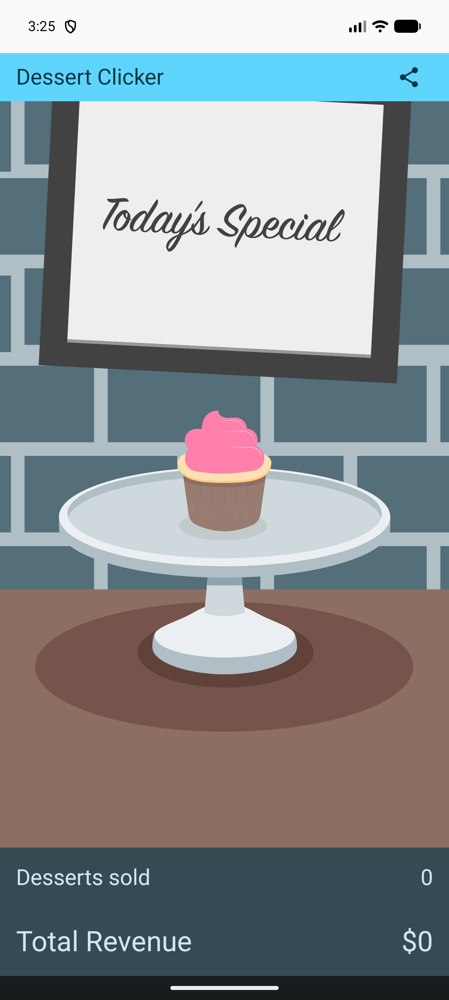
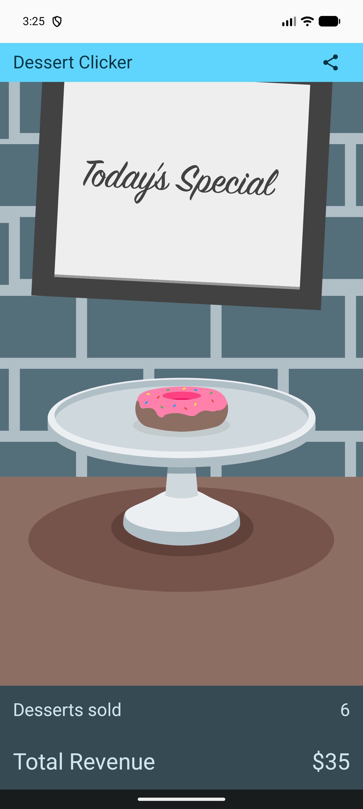
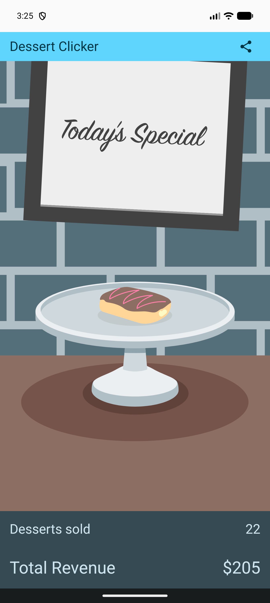
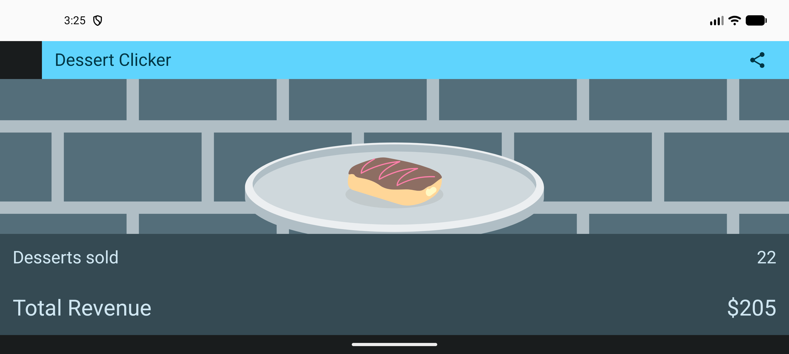

# Dessert Clicker App - Arquitectura ViewModel y Ciclo de Vida en Jetpack Compose 🧁✨

[](https://developer.android.com/)
[](https://kotlinlang.org/)
[](https://developer.android.com/jetpack/compose)
[](https://developer.android.com/topic/architecture)
[](https://developer.android.com/)
[](https://developer.android.com/)

Proyecto y solución técnica integral para las dos actividades oficiales de Google Codelabs:
1. 👉 **[Android Basics with Compose: Stages of the Activity Lifecycle](https://developer.android.com/codelabs/basic-android-kotlin-compose-activity-lifecycle)**
2. 👉 **[Android Basics with Compose: Practice: Add a ViewModel to Dessert Clicker](https://developer.android.com/codelabs/basic-android-kotlin-compose-practice-viewmodel)**

---

## 📸 Capturas de Pantalla (Evidencias de Ejecución)

| 1. Estado Inicial (Cupcake) | 2. Transición de Postre (Donut) | 3. Nivel Avanzado (Éclair) | 4. Rotación Horizontal (Estado Preservado) |
| :---: | :---: | :---: | :---: |
|  |  |  |  |

---

## 🧠 Arquitectura y Flujo Unidireccional de Datos (UDF)

La aplicación implementa el patrón de arquitectura recomendado por Android, desacoplando completamente la lógica de negocio y la gestión del estado de la capa de interfaz visual:

```text
       ┌────────────────────────┐
       │     MainActivity       │  <- Eventos de ciclo de vida (onCreate, onStart, ...)
       └───────────┬────────────┘
                   │
                   ▼
       ┌────────────────────────┐
       │   DessertClickerApp    │  <- Observa dessertUiState con collectAsState()
       └───────────┬────────────┘
                   │  Eventos de usuario (onDessertClicked)
                   ▼
       ┌────────────────────────┐
       │    DessertViewModel    │  <- Administra MutableStateFlow<DessertUiState>
       └───────────┬────────────┘
                   │  Actualiza estado inmutable (copy)
                   ▼
       ┌────────────────────────┐
       │     DessertUiState     │  <- data class (revenue, dessertsSold, currentImage, price)
       └────────────────────────┘
```

### 1. Estado de la Interfaz (`DessertUiState`)
Clase inmutable que encapsula todos los datos requeridos por la vista:
* `currentDessertIndex`: Índice del postre activo en la lista.
* `dessertsSold`: Cantidad acumulada de postres vendidos.
* `revenue`: Total de ingresos generados en dólares ($).
* `currentDessertPrice`: Precio unitario del postre actual.
* `currentDessertImageId`: Recurso drawable del postre actual (`@DrawableRes`).

### 2. ViewModel (`DessertViewModel`)
* Expone `dessertUiState` como un `StateFlow<DessertUiState>` de solo lectura mediante `asStateFlow()`.
* Mantiene el estado interno protegido en un `MutableStateFlow`.
* Maneja la lógica de transición de postres según la producción acumulada (`determineDessertIndex`).
* **Supervivencia a cambios de configuración:** El `ViewModel` retiene intactos los datos de ingresos y postres vendidos al rotar la pantalla, sin requerir `rememberSaveable` en los composables.

### 3. Ciclo de Vida de la Actividad (`MainActivity`)
Se implementaron e instrumentaron con `Log.d(TAG, ...)` todos los métodos de callback del ciclo de vida para auditar transiciones de estado en Logcat:
* `onCreate()`: Inicialización única e inflado de la composición.
* `onStart()`: La actividad pasa a ser visible para el usuario.
* `onResume()`: La actividad adquiere foco e interacción en primer plano.
* `onPause()`: Pérdida de foco temporal (ej. apertura de diálogo de compartir).
* `onStop()`: La actividad pasa al segundo plano (oculta).
* `onDestroy()`: Destrucción por cierre o cambio de configuración.
* `onRestart()`: Reanudación tras haber estado detenida.

---

## 📁 Estructura del Proyecto

```text
DessertClicker/
├── app/src/main/
│   ├── java/com/example/dessertclicker/
│   │   ├── MainActivity.kt        // Ciclo de vida, Logcat y Composables de UI
│   │   ├── data/
│   │   │   ├── Datasource.kt      // Lista estática de postres y reglas de producción
│   │   │   └── DessertUiState.kt  // Modelo inmutable del estado de la pantalla
│   │   ├── model/
│   │   │   └── Dessert.kt         // Data class base del postre
│   │   └── ui/
│   │       ├── DessertViewModel.kt// ViewModel con StateFlow y lógica de negocio
│   │       └── theme/             // Estilos, tipografía y esquema de color Material 3
│   └── res/
│       ├── drawable/              // Recursos gráficos de repostería e iconos
│       └── values/                // Cadenas traducidas, colores y dimensiones
├── screenshots/                   // Evidencias visuales de la app en ejecución
└── entrega_PEA_ViewModel_DessertClicker.txt // Archivo con URL de Git y evidencias
```

---

## 🚀 Cómo Ejecutar el Proyecto

1. **Clonar el repositorio:**
   ```bash
   git clone https://github.com/JhonnyCCM/DessertClicker.git
   ```
2. **Abrir en Android Studio** (Ladybug o posterior).
3. **Sincronizar Gradle** y verificar que la versión de Java configurada sea JDK 17 o 21.
4. **Ejecutar en un Emulador o Dispositivo Físico** con Android 7.0+ (API 24+).
5. **Inspeccionar Logcat:**
   Filtrar por `tag:MainActivity` para observar las trazas del ciclo de vida en tiempo real durante la apertura, cambio a segundo plano y rotación de pantalla.
